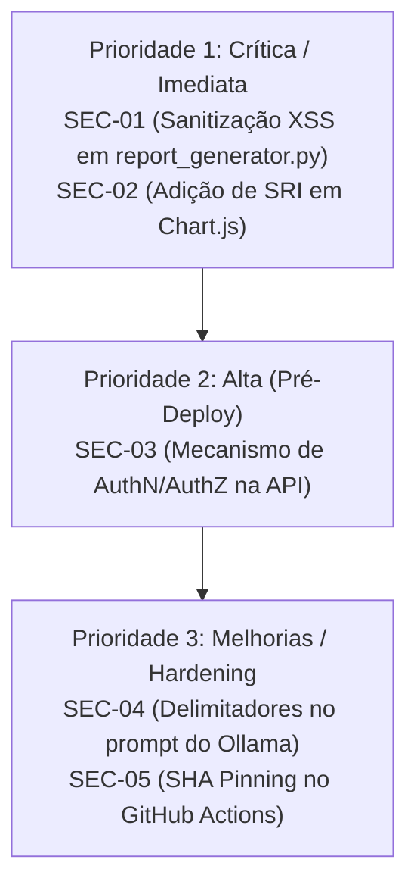

# 📋 HANDOVER TÉCNICO — PR #7 & AUDITORIA DE SEGURANÇA
**Repositório:** `AirtonNettu/aws-cost-monitor`  
**Branch:** `feat/fastapi-snapshot-api`  
**Data:** 30 de Outubro de 2026  
**Status da PR:** Em Draft — Pronto para revisão humana e plano de remediação  

---

## 1. Estado Atual da PR #7 e da Branch

A branch `feat/fastapi-snapshot-api` concluiu a entrega de infraestrutura, contratos e integração da API FastAPI para visualização de snapshots do AWS Cost Monitor, integrando-se deterministicamente com o frontend React/TypeScript.

### Principais Entregas Consolidadas na Branch:
- **API FastAPI (`src/api/app.py`):** Endpoints de leitura implementados com estrita validação Pydantic v2 (`allow_inf_nan=False`, `extra="forbid"`):
  - `GET /api/v1/health`
  - `GET /api/v1/snapshots/latest?days=...&tag=...`
  - `GET /api/v1/runs?limit=...&offset=...&days=...&tag=...`
  - `GET /api/v1/runs/{run_id}`
  - `GET /api/v1/runs/{run_id}/reports/{format}`
- **Persistência Incremental SQLite (`src/database/repository.py`):**
  - Migração idempotente que adiciona novas colunas de metadados (`source`, `tag`, `days`, `estimated`, `timeline_json`, `comparison_json`, `ai_json`, `available_filters_json`, `report_formats_json`) sem perda de dados legados.
  - Índices otimizados para consulta: `idx_runs_days_tag`, `idx_runs_created_at`, `idx_service_costs_run_id`.
  - Tratamento de registros legados: timestamps sem fuso horário UTC retornam HTTP 409 em consultas diretas, sem fabricar dados.
  - Paginação consistente no endpoint `/runs` via filtro SQL `only_compatible=True`.
- **Integridade Financeira FinOps:**
  - Função `ensure_finite_float`: rejeita estritamente `NaN`, `Infinity` e `-Infinity`, sem conversão silenciosa para zero e preservando valores negativos legítimos (créditos/reembolsos da AWS).
  - Função `check_period_equivalence`: validação estrita de períodos contíguos de mesma duração, não sobrepostos (`prev_end <= curr_start`) e com escopos/tags idênticos.
- **Integração com Frontend:**
  - Utilitários de seed sintético (`src/database/seeds.py` e `scripts/seed_snapshots.py`) baseados em fixtures.
  - Configuração de proxy de desenvolvimento no Vite (`frontend/vite.config.ts`).
  - Testes de contrato Zod (`frontend/src/api/contracts.test.ts`).
- **Automação de CI (`.github/workflows/ci.yml`):**
  - Jobs paralelos de backend (Python 3.14 + testes + auditoria de segurança) e frontend (Node.js 22 + lint + vitest + build).
  - Permissões mínimas (`contents: read`) e IMDS AWS desativado.

---

## 2. Os Cinco Achados da Auditoria Cloudflare Security Audit

Auditoria executada conforme as 6 fases da metodologia source-first Cloudflare Security Audit:

| ID | Vulnerabilidade / Achado | Severidade | CWE | Arquivo / Linha | Impacto |
|---|---|---|---|---|---|
| **SEC-01** | **Stored DOM XSS no Relatório HTML standalone** | **Alta** (CVSS 7.4) | [CWE-79](https://cwe.mitre.org/data/definitions/79.html) | `src/reports/report_generator.py:673` | Nomes de serviços e tags AWS são serializados via `json.dumps(chart_labels, ensure_ascii=False)` diretamente dentro de um bloco `<script>` inline. A sequência `</script>` não é escapada, permitindo quebra de contexto e execução de JavaScript arbitrário no navegador ao abrir o relatório baixado ou hospedado no S3. |
| **SEC-02** | **Dependência CDN sem Subresource Integrity (SRI)** | **Média** (CVSS 4.8) | [CWE-353](https://cwe.mitre.org/data/definitions/353.html) | `src/reports/report_generator.py:413` | O Chart.js é carregado via CDN externa (`cdn.jsdelivr.net`) sem hash SRI (`integrity`) e sem `crossorigin="anonymous"`. Se a CDN ou o canal de rede for comprometido, scripts maliciosos podem ser injetados. |
| **SEC-03** | **Ausência de Autenticação/Autorização e IDOR na API** | **Média** (Local) / **Alta** (Rede) | [CWE-306](https://cwe.mitre.org/data/definitions/306.html) / [CWE-639](https://cwe.mitre.org/data/definitions/639.html) | `src/api/app.py:367-560` | Todos os endpoints da API respondem sem validação de credenciais, chaves ou tokens. Os IDs das execuções são inteiros sequenciais (`1, 2, 3...`), permitindo enumeração irrestrita de todo o histórico de custos e relatórios da nuvem caso a porta seja exposta além do loopback local. |
| **SEC-04** | **Risco de Indirect Prompt Injection na Camada de IA** | **Baixa** (CVSS 3.1) | [CWE-74](https://cwe.mitre.org/data/definitions/74.html) | `src/ai/llama_client.py:25-80` | Tags de recursos e alertas são interpolados diretamente no prompt do Ollama em texto livre sem delimitadores rígidos (ex: `<data>...</data>`), possibilitando que tags adversariais alterem o comportamento analítico da IA (desinformação / engenharia social). |
| **SEC-05** | **Actions do GitHub Actions Fixadas por Tag Mutável** | **Baixa / Info** | [CWE-1357](https://cwe.mitre.org/data/definitions/1357.html) | `.github/workflows/ci.yml:26, 29, 54, 57` | As ações `actions/checkout@v4`, `actions/setup-node@v4` e `astral-sh/setup-uv@v6` usam tags mutáveis de versão em vez de hashes SHA imutáveis, gerando risco residual de supply chain attack. |

---

## 3. Correções Pendentes e Prioridades



### Matriz de Remediação Recomendada:

1. **Prioridade 1 — Alta / Bloqueante para Release (SEC-01 e SEC-02):**
   - **Ação:** Sanitizar caracteres `<` como `\u003c` em strings JSON embutidas em blocos `<script>` em `src/reports/report_generator.py`:
     ```python
     safe_labels = json.dumps(chart_labels, ensure_ascii=False).replace("<", "\\u003c")
     safe_values = json.dumps(chart_values).replace("<", "\\u003c")
     ```
   - **Ação:** Incluir hash SRI e `crossorigin="anonymous"` na tag de inclusão do Chart.js:
     ```html
     <script src="https://cdn.jsdelivr.net/npm/chart.js@4.4.8/dist/chart.umd.min.js" integrity="sha384-..." crossorigin="anonymous"></script>
     ```

2. **Prioridade 2 — Média / Antes de Exposição Externa (SEC-03):**
   - **Ação:** Criar dependência FastAPI (`Security(APIKeyHeader)` ou `HTTPBearer`) em `src/api/app.py` controlada por variável de ambiente (ex: `API_KEY_ENABLED=true` / `API_KEY=...`), assegurando que a API permaneça protegida se acessada fora da máquina local.

3. **Prioridade 3 — Baixa / Hardening Contínuo (SEC-04 e SEC-05):**
   - **Ação:** Delimitar os dados de custos com `<cost_data>` no prompt de `src/ai/llama_client.py`.
   - **Ação:** Fixar as actions do GitHub Actions com o commit SHA completo acompanhado de comentário de versão.

---

## 4. Testes e Evidências de CI

Todos os testes e verificações automatizadas de qualidade e segurança encontram-se **100% aprovados** localmente e alinhados à pipeline de CI:

### Backend Python (pytest)
- **Comando:** `uv run pytest -v`
- **Resultado:** **79 passed, 1 warning in 3.77s**
  - `tests/test_api_app.py`: 12 testes (endpoints, health, 404, 409, 422, paginação consistente, finitude de floats, equivalência de períodos).
  - `tests/test_database.py`: 11 testes (migração incremental, seeds, consistência com registros legados, validação de NaN/Infinito e créditos).
  - `tests/test_cli.py`: 3 testes.
  - `tests/test_cost_analyzer.py`: 10 testes.
  - `tests/test_cost_explorer.py`: 5 testes.
  - `tests/test_finops_rules.py`: 9 testes.
  - `tests/test_lambda_handler.py`: 2 testes.
  - `tests/test_llama_client.py`: 5 testes.
  - `tests/test_report_formats.py`: 13 testes.
  - `tests/test_report_generator.py`: 5 testes.
  - `tests/test_security_audit.py`: 4 testes.

### Auditoria de Segurança NETTO LABS
- **Comando:** `uv run python scripts/security_audit.py`
- **Resultado:** **🟢 PASSED (0 falhas críticas, 0 alertas, 0 credenciais expostas)**

### Frontend React / TypeScript (vitest, ESLint & Build)
- **Linter:** `npm --prefix frontend run lint` -> **0 warnings, 0 erros**
- **Testes Unitários e de Contrato:** `npm --prefix frontend test` -> **8 arquivos aprovados, 46 testes aprovados** (incluindo testes de contrato Zod com rejeição de `NaN`/`Infinity` e validação de créditos).
- **TypeScript & Build:** `npm --prefix frontend run build` -> **Build concluído com sucesso em 4.31s** via `tsc -b && vite build`.

---

## 5. Próximos Passos para a Remediação

1. **Sessão de Remediação (Branch isolada ou continuação da PR #7):**
   - Aplicar a correção do SEC-01 e SEC-02 em `src/reports/report_generator.py`.
   - Adicionar teste unitário de segurança em `tests/test_report_formats.py` verificando que tags contendo `</script>` são sanitizadas e não quebram o HTML.
2. **Revisão Humana dos Contratos:**
   - Avaliar se a autenticação de API (SEC-03) deve ser configurada nesta PR ou em PR subsequente focada em autorização e perfis de usuário.
3. **Validação da Pipeline no GitHub:**
   - Acompanhar a execução dos workflows acionados pelos commits na branch `feat/fastapi-snapshot-api`.

---

## 6. Restrições Obrigatórias e Governança

- 🚫 **SEM MERGE:** A branch `feat/fastapi-snapshot-api` não deve ser mesclada na branch `main` sem aprovação formal e revisão humana completa.
- 🚫 **SEM DEPLOY:** Nenhum deploy em ambiente serverless, CloudFront ou S3 deve ser executado neste momento.
- 🚫 **CUSTO ZERO:** Proibido executar consultas diretas à API do AWS Cost Explorer durante testes locais ou na esteira de CI.
- 🔒 **PONTO DE PARADA:** PR mantida em **Draft** para deliberação do time e aprovação humana.
