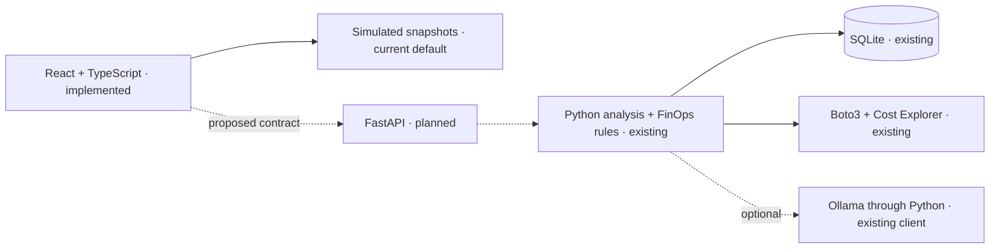
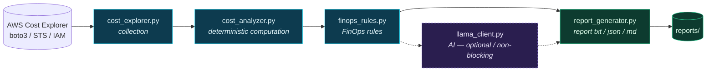

<p align="right"><a href="README.md">Português</a> · <strong>English</strong></p>

# AWS Cost Monitor — FinOps with AI

A Python tool for monitoring and analyzing AWS costs, focused on **FinOps**
practices. It queries account costs through the **AWS Cost Explorer**, groups
spend by service, runs deterministic analysis in Python, and uses an **AI layer
(local Llama)** to interpret the results and produce a final report.

> **Project principle:** *Python computes. AI interprets.*
> Calculation logic is deterministic and lives in Python. The AI layer is kept
> decoupled from the calculation, so the model can be swapped (local model,
> OpenAI, Claude, Gemini, Amazon Bedrock) without touching the analysis logic.
> The AI **never** computes or invents financial values: it receives numbers
> that are already calculated and only interprets them.

---

## React + TypeScript dashboard

The frontend in `frontend/` implements overview, cost analysis, FinOps alerts,
AI analyst, and history, with dark/light themes and a responsive layout.
**It starts with clearly labeled simulated data. A FastAPI backend does not
exist yet.** The Streamlit dashboard and Python modules remain available.

**React presents. FastAPI orchestrates (planned). Python computes. Ollama interprets.**



### Run the frontend

Requires Node.js **22.12+** (validated with 24.19.0) and npm. Browsing the mock
mode does not require AWS, Python, or Ollama.

```bash
cd frontend
npm ci
npm run dev
```

Open the address printed by Vite in your local environment (default port 5173).
Use `npm run build` and `npm run preview` to inspect the production distribution
(default port 4173). Future hosting must configure an SPA fallback to `index.html`.
No deployment was performed in this stage. The UI language is Portuguese.

### Features and boundaries

- USD metrics, estimates, and collection timestamps; totals, percentages, and
  alerts come from the snapshot. Variation appears only for equivalent periods.
- Temporal and service charts, ranking, search, and sorting. Expandable daily
  tables provide a textual alternative to charts.
- Period (7/30/90 days) and tag retrieve complete snapshots. Service and search
  filter the table/distribution; they do not recalculate KPIs, timeline, or alerts.
- Alert severity filtering, threshold-based growth, concentration, and ranking.
  Statistical anomaly detection remains on the roadmap.
- AI summary, optional sections, processing and unavailable states. Initial AI
  content is illustrative; **the browser never calls Ollama**.
- History, snapshot details, and side-by-side comparison of two runs, without
  computing variation between potentially overlapping periods.
- Skeletons, retryable errors, empty states, keyboard support, mobile navigation,
  and persisted themes. No polling or refetch on window focus.
- Export is disabled in mock mode; it requires a backend-advertised format and a
  working download endpoint.

### Frontend stack and structure

React, strict TypeScript, Vite, Tailwind CSS, React Router, TanStack Query,
Recharts, Lucide React, Vitest, and React Testing Library. Zod validates HTTP
contracts at runtime. Exact versions are locked in `package-lock.json`.

```text
frontend/
├── src/api/          # contracts, validation, HTTP client with timeout/abort
├── src/app/          # routes, layout, themes, context, queries
├── src/components/   # shared metrics, charts, tables, states
├── src/features/     # overview, alerts, ai, history (costs uses SnapshotPage)
├── src/mocks/        # isolated adapter and precomputed synthetic fixtures
├── src/lib/          # date and currency formatting
├── src/test/         # DOM test setup
├── src/styles.css    # Tailwind and responsive theme tokens
└── package-lock.json
```

### Public Vite variables

No configuration file is required. To customize, create `frontend/.env.local`
(git-ignored) and restart Vite. **Never put secrets in VITE_* variables: they
are public and embedded in the build.**

| Variable | Default | Purpose |
| --- | --- | --- |
| `VITE_DATA_MODE` | `mock` | `mock` or `api`; API failures never silently switch to mocks |
| `VITE_API_BASE_URL` | `/api/v1` | Future FastAPI base URL, only used in `api` mode |
| `VITE_MOCK_SCENARIO` | `success` | `success`, `empty`, `error`, `loading`, `ai-unavailable`, `ai-processing` |

Example: `VITE_MOCK_SCENARIO=empty npm run dev`. The `loading` scenario waits
eight seconds; it does not collect real data. Financial fixtures are fictional
and were precomputed with existing Python modules. Mock mode makes no application
HTTP requests and does not write to SQLite.

### Future contracts, testing, and next steps

**Proposed endpoints**, not yet implemented: `GET /snapshots/latest`, `GET /runs`,
`GET /runs/{id}`, and `GET /runs/{id}/reports/{format}`, under `/api/v1`.
See [docs/frontend/api-contract.md](docs/frontend/api-contract.md) for payloads,
filters, dates, credits, errors, and required Python adaptation.

```bash
cd frontend
npm test
npm run test:coverage
npm run lint
npm run build
# From the repository root, validate the preserved Python backend:
uv run pytest -q
uv run python scripts/security_audit.py
```

The existing Python Ollama client returns free text. Structured sections, model
metadata, and API processing still require backend work. The UI handles absent
fields without inventing advice. Next work: a cached snapshot FastAPI service,
authentication/authorization, CORS, filter metadata, daily-series persistence,
downloads, and AI improvements. Do not connect the browser directly to AWS or
duplicate critical FinOps logic in TypeScript.

Audit and acceptance criteria: [design](docs/frontend/design.md). Plan:
[implementation-plan](docs/frontend/implementation-plan.md). Validation and delivery:
[validation](docs/frontend/validation.md).

---

## About the project

AWS Cost Monitor is a **Cloud / FinOps / Python** portfolio project. The core
idea is to clearly separate two responsibilities:

1. **Deterministic computation** — Python queries AWS, sums, filters, and
   calculates percentages and variations. Always the same result for the same
   input.
2. **Interpretation** — an AI layer that reads the already-calculated numbers
   and produces a natural-language reading, pointing out possible waste or areas
   of attention.

This separation is intentional: it keeps the critical part (the numbers)
auditable and predictable, and treats the AI as a replaceable, optional
component.

---

## Goals

- Query AWS account costs via the AWS Cost Explorer.
- Group costs by service.
- Run deterministic analysis in Python (totals, percentages, period-over-period
  variation).
- Interpret the results with a decoupled AI layer.
- Generate a final report from the analyzed data and the interpretation.

---

## Architecture



> **Python computes** (blue nodes: collection, computation, and FinOps rules).
> **AI interprets** (dashed purple node: optional and non-blocking — if Llama is
> down, the report is still generated).

Flow orchestration lives in `src/main.py`, and parameters (region, day window,
Llama endpoint, report format) are centralized in `src/config.py`.

---

## Application flow

1. `cost_explorer.get_costs()` queries the AWS Cost Explorer and returns a list
   of periods, each with service groups and their costs.
2. `cost_analyzer.analyze_costs()` groups by service, computes the total, filters
   services with positive cost, computes each service's percentage, and
   identifies the highest-cost service. **Returns a structured dictionary.**
3. `cost_analyzer.compare_periods()` compares the two most recent periods and
   computes the percentage variation.
4. `llama_client.interpret()` receives the structured data, builds a prompt with
   the already-calculated values, and asks Llama for a textual interpretation.
   If Llama is unavailable, it raises a clear error that the orchestrator handles.
5. `report_generator.build_report()` assembles the final report (data +
   interpretation) and `save_report()` writes a file into `reports/`.

---

## Current features

- **AWS connection check** (`src/test_aws.py`): uses STS `get_caller_identity`
  to confirm credentials and show `Account` and `ARN`.
- **Cost collection** (`src/aws/cost_explorer.py`):
  - Cost Explorer client in a configurable region (default `us-east-1`).
  - Configurable day window (default 30), `MONTHLY` granularity,
    `UnblendedCost` metric, grouped by `SERVICE`.
  - Explicit handling of missing/incomplete credentials, insufficient permission,
    and Cost Explorer errors (via `CostExplorerError`).
- **Cost analysis** (`src/analysis/cost_analyzer.py`): grouping by service, total
  cost, positive services, percentage per service, largest service, period
  comparison, and safe division-by-zero handling. All functions **return
  structured data**.
- **Deterministic FinOps rules** (`src/analysis/finops_rules.py`): from the
  already-calculated data, it generates alerts for cost growth between periods,
  cost concentration in a single service, and a ranking of the largest services.
  Configurable thresholds. Deterministic — uses neither AI nor network.
- **AI interpretation** (`src/ai/llama_client.py`): sends the calculated data
  (including FinOps alerts) to a local Llama (Ollama-compatible API) and returns
  the interpretation. Handles unavailability via `LlamaUnavailableError`, without
  masking the error and without inventing values.
- **Report** (`src/reports/report_generator.py`): assembles and saves a report
  with period, total, cost and percentage per service, largest service,
  comparison, FinOps alerts, and the AI interpretation. Configurable format:
  **text** (default), **JSON**, or **Markdown**.
- **Orchestration** (`src/main.py`): runs the complete flow with error handling
  at each step.
- **Tests** (`tests/`): `pytest` suite with mocks, with no dependency on the
  real AWS account.

---

## Tech stack

- **Python** `>= 3.14` (see `.python-version` and `pyproject.toml`)
- **[uv](https://docs.astral.sh/uv/)** — environment and dependency management
- **[boto3](https://boto3.amazonaws.com/v1/documentation/api/latest/index.html)** — AWS SDK for Python
- **[streamlit](https://streamlit.io/)** — interactive web dashboard for bill visualization and historical analysis
- **[sqlite3](https://docs.python.org/3/library/sqlite3.html)** — local persistence for cost snapshots and execution history
- **[Chart.js](https://www.chartjs.org/)** — interactive visual charts in the exportable HTML report
- **[requests](https://requests.readthedocs.io/)** — HTTP call to the Llama server
- **[python-dotenv](https://pypi.org/project/python-dotenv/)** — reads config from a `.env` file (optional in Serverless runtime)
- **[pytest](https://docs.pytest.org/)** — automated unit and integration tests with mocks (59 tests)
- **AWS Cost Explorer** / **AWS STS** — cost querying and identity verification
- **AWS Lambda** / **Amazon EventBridge** / **Amazon S3** — zero-cost (Free Tier) 24/7 serverless architecture
- **Local Llama** (e.g. [Ollama](https://ollama.com/)) — decoupled AI interpretation model

---

## Project structure

```
aws-cost-monitor/
├── src/
│   ├── main.py                 # orchestrates the complete flow (CLI with flags)
│   ├── config.py               # centralized configuration (.env / env vars)
│   ├── test_aws.py             # AWS connection test (STS)
│   ├── aws/
│   │   └── cost_explorer.py    # Cost Explorer collection (DAILY/MONTHLY, pagination, tags)
│   ├── analysis/
│   │   ├── cost_analyzer.py    # deterministic cost analysis
│   │   └── finops_rules.py     # FinOps rules (growth, concentration, ranking, tags)
│   ├── ai/
│   │   └── llama_client.py     # AI interpretation layer (Llama)
│   ├── database/
│   │   └── repository.py       # SQLite historical snapshot persistence
│   ├── dashboard/
│   │   └── app.py              # Streamlit interactive web dashboard
│   └── reports/
│       └── report_generator.py # report generation (txt/json/md/html)
├── tests/                      # test suite with pytest + mocks (59 tests)
│   ├── conftest.py
│   ├── test_cli.py
│   ├── test_cost_analyzer.py
│   ├── test_cost_explorer.py
│   ├── test_database.py
│   ├── test_finops_rules.py
│   ├── test_lambda_handler.py
│   ├── test_llama_client.py
│   ├── test_report_formats.py
│   └── test_report_generator.py
├── docs/                       # detailed technical documentation
│   ├── architecture.md
│   ├── aws-permissions.md
│   ├── reports.md
│   └── serverless-deploy.md    # Lambda + EventBridge + S3 Website deploy guide
├── data/.gitkeep               # SQLite database location (data/costs.db git-ignored)
├── reports/.gitkeep            # generated reports (content not versioned)
├── dashboard.py                # entrypoint shortcut for Streamlit dashboard
├── lambda_function.py          # serverless AWS Lambda handler
├── main.py                     # shortcut delegating to src/main.py
├── LICENSE
├── pyproject.toml
├── uv.lock
└── README.md
```

---

## How the cost analysis works

The analysis in `src/analysis/cost_analyzer.py` is fully deterministic.

### `analyze_costs(costs)` → `dict`

Returns `services`, `total_cost`, `positive_services`, `percentages`,
`largest_service`, and `has_positive_cost`.

1. Accumulates the value (`UnblendedCost.Amount`) per service across all periods.
2. Sums the **total cost**.
3. Filters **services with positive cost** (value greater than zero).
4. If the total is positive, computes each service's **share percentage**.
5. Identifies the **highest positive-cost service**.

### `compare_periods(costs)` → `dict | None`

Returns `None` when there are fewer than two periods. Otherwise it returns
`previous_total`, `current_total`, and `variation`.

### Division-by-zero handling

When the previous period has a total cost **equal to zero**, the percentage
variation cannot be computed. The application **does not attempt the division**
and sets the variation to `None`:

```python
if previous_total != 0:
    variation = ((current_total - previous_total) / previous_total) * 100
else:
    variation = None
```

---

## AWS Cost Explorer integration

Collection lives in `src/aws/cost_explorer.py` and uses `boto3`:

- **Client:** `boto3.client("ce", region_name=config.AWS_REGION)` (default `us-east-1`)
- **Period (`TimePeriod`):** from the last `COST_PERIOD_DAYS` days (default 30) up to today.
- **Granularity:** `MONTHLY` · **Metric:** `UnblendedCost` · **Grouping:** `SERVICE` dimension

The function iterates over `ResultsByTime` and organizes each period with
`start`, `end`, `estimated`, and `groups`. Errors are converted into
`CostExplorerError` with clear messages.

---

## AWS configuration

1. **Configure the AWS CLI** with your credentials:

    ```bash
    aws configure
    ```

    boto3 will automatically use the configured credentials.

2. **IAM permissions (least privilege).** The identity only needs:
    - `ce:GetCostAndUsage`
    - `sts:GetCallerIdentity`

    ```json
    {
      "Version": "2012-10-17",
      "Statement": [
        {
          "Effect": "Allow",
          "Action": ["ce:GetCostAndUsage", "sts:GetCallerIdentity"],
          "Resource": "*"
        }
      ]
    }
    ```

> **Never** put an Access Key, Secret Key, or any credential in the repository.

---

## Installation

Prerequisites: [uv](https://docs.astral.sh/uv/getting-started/installation/) and Python 3.14+.

```bash
git clone https://github.com/AirtonNettu/aws-cost-monitor
cd aws-cost-monitor

# Environment + dependencies (includes the dev group with pytest)
uv sync --dev
```

---

## Environment configuration

AWS credentials come from the local AWS CLI configuration. All other parameters
are read from environment variables (optionally from a `.env` file at the root,
loaded via `python-dotenv`). They all have safe defaults — the application runs
without `.env`.

| Variable           | Default                  | Description                                          |
|--------------------|--------------------------|------------------------------------------------------|
| `AWS_REGION`       | `us-east-1`              | Cost Explorer client region                          |
| `COST_PERIOD_DAYS` | `30`                     | Analysis window in days                              |
| `COST_GRANULARITY` | `MONTHLY`                | Query granularity (`MONTHLY` or `DAILY`)             |
| `COST_METRIC`      | `UnblendedCost`          | Cost metric                                          |
| `COST_TAG_KEY`     | `None` (optional)        | Cost Allocation Tag key (e.g. `Environment`)         |
| `AI_ENABLED`       | `true`                   | Enables/disables the AI layer                        |
| `LLAMA_BASE_URL`   | `http://localhost:11434` | Llama server endpoint (Ollama-compatible)            |
| `LLAMA_MODEL`      | `llama3`                 | Model name                                           |
| `LLAMA_TIMEOUT`    | `60`                     | Llama call timeout (seconds)                         |
| `FINOPS_GROWTH_THRESHOLD` | `20.0`            | Total-cost growth (%) that triggers an alert         |
| `FINOPS_CONCENTRATION_THRESHOLD` | `50.0`     | Service share (%) that triggers an alert             |
| `FINOPS_TOP_N`     | `5`                      | Number of services in the "top N" ranking            |
| `REPORT_FORMAT`    | `txt`                    | Report format: `txt`, `json`, `markdown`, or `html`  |
| `REPORTS_DIR`      | `reports`                | Folder where reports are saved                       |
| `S3_BUCKET_NAME`   | `None` (optional)        | S3 bucket name for serverless automated web deploy   |

Example `.env` (not versioned):
```env
AWS_REGION=us-east-1
COST_PERIOD_DAYS=30
COST_GRANULARITY=MONTHLY
COST_TAG_KEY=Environment
AI_ENABLED=true
LLAMA_BASE_URL=http://localhost:11434
LLAMA_MODEL=llama3
FINOPS_GROWTH_THRESHOLD=20
FINOPS_CONCENTRATION_THRESHOLD=50
FINOPS_TOP_N=5
REPORT_FORMAT=html
```

> The AI layer is optional. With `AI_ENABLED=false`, or with Llama down, the
> report is generated normally, just without the interpretation (the reason is
> recorded in the report).

---

## Running

### 1. Interactive Web Dashboard (Streamlit)
Access the web graphical dashboard with interactive charts, KPIs, FinOps alert center, and historical invoices saved in SQLite:
```bash
uv run streamlit run dashboard.py
# or alternatively:
uv run python main.py --dashboard
```

### 2. Command Line Interface (CLI with flags)
Customize your run directly using command-line arguments:
```bash
# Full report in the terminal
uv run python main.py

# Standalone interactive HTML report with Chart.js charts (saved to reports/)
uv run python main.py --format html

# Daily granularity analysis for the last 15 days in Markdown
uv run python main.py --days 15 --granularity DAILY --format markdown

# Filter by AWS Cost Allocation Tag (FinOps)
uv run python main.py --tag Environment --format html

# Fast execution without AI outputting structured JSON
uv run python main.py --format json --no-ai

# View all CLI options
uv run python main.py --help
```

### 3. Serverless Deployment on AWS (100% Free Tier)
The project includes serverless automation to monitor costs 24/7 at zero infrastructure expense:
- **AWS Lambda** runs daily triggered by an **Amazon EventBridge** schedule (`cron(0 11 * * ? *)`).
- Generates the interactive HTML dashboard in ~4 seconds and deploys it directly to an **Amazon S3 Static Website Hosting** bucket.
- Public web access with zero computing charge on page reloads and no risk of API billing spikes.
- Check the complete guide in [`docs/serverless-deploy.md`](docs/serverless-deploy.md).

### 4. Diagnostic Scripts
```bash
# Check AWS STS credentials and identity
uv run python src/test_aws.py

# Run standalone modules (useful for debugging)
uv run python -m src.aws.cost_explorer
uv run python -m src.analysis.cost_analyzer
```

---

## Sample output

> Values are **illustrative**. Real output depends on your AWS account.

Connection check (`test_aws.py`):
```
AWS connected successfully
Account: 123456789012
ARN: arn:aws:iam::123456789012:user/example
```

Final report (`src/main.py`):
```
============================================================
AWS COST MONITOR — COST REPORT
============================================================
Generated at: 2026-10-01 14:30:00
Period analyzed: 2026-09-01 to 2026-10-01

Total cost: 50.00 USD

Cost per service:
  - Amazon EC2: 30.00 USD (60.0%)
  - Amazon S3: 10.00 USD (20.0%)
  - AWS Lambda: 10.00 USD (20.0%)

Largest service: Amazon EC2

------------------------------------------------------------
Period Comparison:
  Previous period: 0.00 USD
  Current period:  50.00 USD
  Variation: unavailable (previous period cost was zero).

------------------------------------------------------------
FinOps Alerts:
  - [WARNING] Service 'Amazon EC2' accounts for 60.0% of total cost (threshold: 50.0%).
  - [INFO] Top 3 services by cost: Amazon EC2 (30.00 USD), Amazon S3 (10.00 USD), AWS Lambda (10.00 USD).

------------------------------------------------------------
AI Interpretation:
  Unavailable. Could not connect to Llama at http://localhost:11434. ...
============================================================
```

The same content can be produced as **JSON** (`REPORT_FORMAT=json`), **Markdown** (`REPORT_FORMAT=markdown`), or standalone **HTML** (`REPORT_FORMAT=html`).

---

## Security

- **Never** store AWS credentials in Git.
- Provide credentials via the **AWS CLI** / environment variables.
- Apply **least-privilege IAM** permissions (`ce:GetCostAndUsage`, `sts:GetCallerIdentity`).
- **Do not commit** `.env` files, SQLite databases, or generated reports.

The `.gitignore` strictly prevents versioning of:
```
.venv/            # virtual environment
__pycache__/      # Python bytecode cache
*.pyc             # compiled Python files
.pytest_cache/    # pytest test cache
.env              # environment files and secrets (.env, .env.*, *.env)
reports/*         # generated reports (keeps .gitkeep)
data/*            # collected data and SQLite databases (keeps .gitkeep)
*.db, *.sqlite    # SQLite database files
*.zip             # Lambda deployment packages
```

---

## Testing

Tests use `pytest` and **mocks**, without touching the real AWS account or Llama.
They cover all critical logic: total cost, grouping (including accumulation across periods), percentages, largest service, period comparison, division-by-zero handling, empty data, negative values/adjustments, FinOps rules (growth, concentration, top N, untagged resources), SQLite persistence, AWS Lambda handler, CLI arguments, AI client, and multi-format report generation (text, JSON, Markdown, HTML).

```bash
uv run pytest -v
```

---

## Roadmap

### Already implemented (v0.1.0 & v0.2.0)

- [x] Modern Python environment with `uv`.
- [x] AWS connection check via STS.
- [x] Cost collection in Cost Explorer with dynamic parameters.
- [x] Support for `DAILY` and `MONTHLY` granularities with automatic pagination (`NextPageToken`).
- [x] Support for AWS Cost Allocation Tags filtering (`--tag`).
- [x] Deterministic analysis returning structured data (total, positives, %, largest service).
- [x] Period comparison with division-by-zero handling.
- [x] Deterministic FinOps rules (growth, concentration, top N, and untagged resources alert).
- [x] Decoupled AI layer (Llama) with unavailability handling.
- [x] Report generation in multiple formats: text, JSON, Markdown, and interactive HTML with Chart.js.
- [x] Interactive and responsive web dashboard in Streamlit (`dashboard.py`).
- [x] Historical snapshot persistence in local SQLite (`data/costs.db`).
- [x] Full CLI with argument parsing (`--days`, `--granularity`, `--format`, `--tag`, `--no-ai`, `--no-db`, `--dashboard`).
- [x] Serverless 100% Free Tier architecture (AWS Lambda + Amazon EventBridge daily cron + Amazon S3 Website).
- [x] Complete automated test suite with mocks (59 tests, 100% passing).
- [x] Centralized configuration in `src/config.py` with robust error handling at each step.

### In progress / planned (v0.3.0)

- [ ] Push notification alerts (SNS / Slack / Discord / Email based on FinOps rules).
- [ ] Support for multiple AI providers via abstract interface (OpenAI, Claude, Gemini, Amazon Bedrock).
- [ ] Statistical anomaly detection using historical SQLite baseline.

---

## Current limitations

- AI interpretation relies on a running **local Llama** (or Ollama-compatible API); without it, reports are generated normally with intact calculations and FinOps alerts.
- In the AWS Lambda serverless deployment, the local AI layer is disabled by default (`AI_ENABLED=false`) to ensure fast execution (~4s) and strictly remain within AWS Free Tier limits.
- AWS Cost Explorer has an inherent delay of up to 24 hours for recent data ingestion on AWS's end.

## Technical documentation

Detailed technical documentation lives in [`docs/`](docs/README.md): architecture,
code structure, data flow, configuration, permissions, AI integration, report
formats, error handling, and testing.

---

## License

This project is licensed under the MIT License — see the [LICENSE](LICENSE) file.

---

## Author

**José Airton de Carvalho Neto**

Cloud / FinOps / Python portfolio project.

- GitHub: [@AirtonNettu](https://github.com/AirtonNettu)
- LinkedIn: [jose-airton-cloud](https://www.linkedin.com/in/jose-airton-cloud/)
