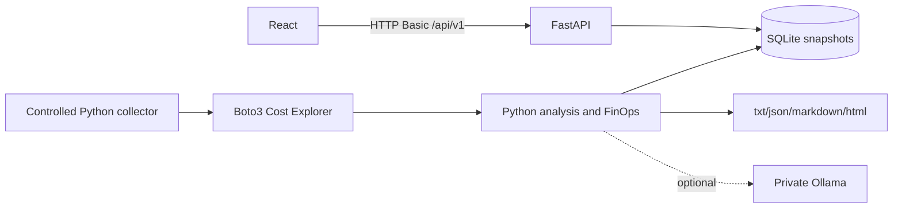

<p align="right"><a href="README.md">Português</a> · <strong>English</strong></p>

# AWS Cost Monitor — Cloud Engineering and FinOps v0.2

This portfolio project turns scattered AWS cost data into deterministic analysis, persistent snapshots, and an interactive dashboard. Reading the dashboard never triggers a potentially billable AWS query.

**React presents. FastAPI serves snapshots. Python computes. Ollama optionally interprets.**

## Verified state

- Existing Python/Boto3/FinOps calculations, four local report formats and Streamlit preserved.
- Authenticated FastAPI /api/v1 and additive SQLite snapshot persistence implemented and tested locally.
- React consumes the real local API; isolated, clearly labeled mock mode remains available.
- Ollama's existing optional text client remains; real model inference was not verified.
- CloudFormation validated statically only; no AWS provisioning, deployment or cost measurement.
- CI workflow added; GitHub execution is not yet verified. No claim of Free Tier eligibility or zero cost.



## Local run without AWS

Requires Python 3.14+, uv, Node.js22.12+ (tested with24). UI language is Portuguese.

```bash
uv sync --frozen --dev
uv run python scripts/seed_demo.py --database data/demo.db
export DATABASE_PATH=data/demo.db
export API_USERNAME=operator
read -r -s -p 'Local API password (16+ ASCII characters): ' API_PASSWORD
export API_PASSWORD
uv run uvicorn src.api.app:create_app --factory --no-access-log --host 127.0.0.1 --port 8000
```

In another terminal:

```bash
cd frontend
npm ci
VITE_DATA_MODE=api npm run dev -- --host 127.0.0.1
```

Open Vite's local address and sign in with the server credential. Demo data uses source=mock through the real HTTP transport. The seed refuses to overwrite an existing database. `npm run dev` without VITE_DATA_MODE defaults to isolated mocks.

## Configuration and security

Server-only variables: DATABASE_PATH (default data/costs.db), API_USERNAME (operator), API_PASSWORD (required16–256ASCII characters). The API refuses missing credentials. Single-operator, workspace-wide read access; no multiuser or tenant authorization. TLS and brute-force protection are required before external publication.

Public frontend variables: VITE_DATA_MODE=mock|api, VITE_API_BASE_URL=/api/v1, VITE_MOCK_SCENARIO=success|empty|error|loading|ai-unavailable|ai-processing. **Never put secrets in VITE_* variables.** Authorization is kept only in React memory and discarded on logout/reload. Same-origin Vite proxy targets127.0.0.1:8000; production hosting/reverse proxy is not automatic.

AWS credentials stay in boto3's backend credential chain. Ollama is accessed only from Python. No API GET calls AWS or AI; failures never silently turn into mock data. SQL reads are read-only/parameterized; errors contain safe codes and request IDs.

## Features and contracts

Overview metrics, daily timeline when available, distribution/ranking, period/tag filters, service search/sort, deterministic alerts, history/details/comparison, dark/light themes, mobile and keyboard support. Financial totals, shares and comparisons remain Python responsibilities. Credits are preserved; comparison requires adjacent periods of equal duration and scope. Legacy rows lacking provenance are retained for Streamlit and are not silently promoted to API snapshots.

Authenticated routes: GET /api/v1/snapshots/latest, /runs, /runs/{id}, /runs/{id}/reports/json|csv, /openapi.json. Public /health/live; authenticated /health/ready. The browser disables export for demo snapshots. CLI txt/markdown/html remain available locally. [Implemented API contract](docs/api-v02.md).

Existing commands remain:

```bash
uv run python main.py --help
# These require AWS access and can incur charges; not part of the demo:
uv run python main.py --format json --no-ai
uv run streamlit run dashboard.py
```

## Validation and operations

```bash
uv run pytest -q
uv run python scripts/security_audit.py
uv run cfn-lint infra/serverless.yaml
cd frontend
npm test
npm run test:contract
npm run lint
npm run build
```

Tests use synthetic data/mocks. A contract check validates actual FastAPI TestClient JSON with the React Zod schema. Browser testing uses the running local API and SQLite. [Evidence](docs/validation-v02.md). Structured JSON logs, correlation IDs, health/readiness, bounded SDK retries/timeouts, daily reservations, backup and recovery are covered in the [runbook](docs/runbook-v02.md).

## Infrastructure and cost limitations

The template prepares a Lambda collector, disabled daily EventBridge schedule, private encrypted S3 bucket, scoped IAM and retained logs. It does not host the API/SPA or store SQLite durably. The report bucket is retained when the stack is deleted and may continue to incur charges. [Deployment/removal procedure](docs/infrastructure-v02.md).

There is no verified zero-cost guarantee: CE pagination/retries, Lambda duration, S3 versions/requests/transfers, logs/events and CI can cost money. Free Tier eligibility and prices require account-specific verification before activation. [Cost model](docs/costs-v02.md).

## Documentation and future work

[Technical audit](docs/audits/technical-audit-v02.md), [architecture/requirements](docs/architecture-v02.md), [ADR](docs/adr/001-v02-boundaries.md), [roadmap](docs/roadmap-cloud-finops-v02.md).

Structure: src/api (HTTP/auth), src/application (models/mapping), src/database (persistence), src/operations (collector/guard), existing analysis/aws/ai/reports modules, frontend, infra, tests and docs.

Planned: provenance-aware legacy import, Decimal migration with equivalence tests, corporate authentication/rate limiting, structured/evaluated AI, durable cloud API storage, operational metrics/alerts and controlled AWS validation. Forecasting, statistical anomalies and multi-account remain roadmap.

MIT — José Airton de Carvalho Neto / NETTO LABS. [GitHub](https://github.com/AirtonNettu).
