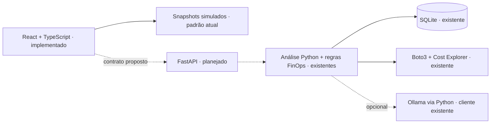
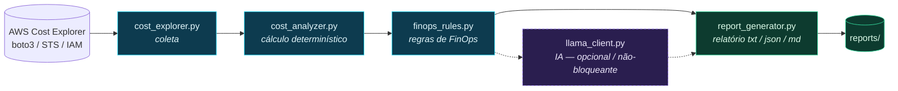

<p align="right"><strong>Português</strong> · <a href="README.en.md">English</a></p>

# AWS Cost Monitor — FinOps com IA

Ferramenta de monitoramento e análise de custos da AWS desenvolvida em Python, com foco em práticas de **FinOps**. O projeto consulta os custos da conta através do **AWS Cost Explorer**, organiza os gastos por serviço, executa análises determinísticas em Python e usa uma camada de **IA (Llama local)** para interpretar os resultados e gerar um relatório final.

> **Princípio do projeto:** *Python calcula. IA interpreta.*
> A lógica de cálculo é determinística e vive em Python. A camada de IA é mantida desacoplada do cálculo, de forma que o modelo possa ser trocado (modelo local, OpenAI, Claude, Gemini, Amazon Bedrock) sem alterar a lógica de análise. A IA **nunca** calcula ou inventa valores financeiros: ela recebe os números já calculados e apenas os interpreta.

---

## Dashboard React + TypeScript

O frontend em `frontend/` implementa visão geral, análise de custos, alertas FinOps,
analista IA e histórico, com tema escuro/claro e layout responsivo. **Ele inicia com
dados simulados claramente identificados. Ainda não existe backend FastAPI.**
O dashboard Streamlit e todos os módulos Python continuam disponíveis.

**React apresenta. FastAPI orquestra (planejado). Python calcula. Ollama interpreta.**



### Executar o frontend

Requer Node.js **22.12+** (validado com 24.19.0) e npm. Não exige AWS, Python ou
Ollama para navegar no modo mock.

```bash
cd frontend
npm ci
npm run dev
```

Abra o endereço informado pelo Vite no seu ambiente local (porta padrão 5173).
Para validar a distribuição de produção: `npm run build` e `npm run preview`
(porta padrão 4173). Em hospedagem futura, as rotas da SPA precisam de fallback
para `index.html`; nenhum deploy foi feito nesta etapa.

### Funcionalidades e limites

- KPIs em USD, estimativas e data da coleta; totais, percentuais e alertas vêm do
  snapshot. A variação só aparece quando o backend indica períodos equivalentes.
- Evolução temporal, distribuição por serviço, ranking, busca e ordenação. Tabela
  diária expandível fornece alternativa textual aos gráficos.
- Período (7/30/90 dias) e tag buscam snapshots completos. Serviço e pesquisa
  restringem tabela/distribuição; não recalculam KPIs, evolução ou alertas.
- Alertas por severidade, crescimento acima do limiar, concentração e ranking.
  Detecção estatística de anomalias continua no roadmap.
- IA com resumo, seções opcionais e estados de processamento/indisponibilidade.
  Todo texto inicial é ilustrativo; **o navegador não chama Ollama**.
- Histórico, detalhe e comparação de duas execuções lado a lado. Não calcula
  variação entre execuções que podem ter períodos sobrepostos.
- Skeletons, erro com nova tentativa, estados vazios, teclado, menu móvel e tema
  persistido. Sem polling ou atualização ao focar a janela.
- Exportação desabilitada nos mocks. Será habilitada somente quando o backend
  anunciar formatos e disponibilizar o endpoint de download.

### Stack e diretórios do frontend

React, TypeScript strict, Vite, Tailwind CSS, React Router, TanStack Query,
Recharts, Lucide React, Vitest e React Testing Library. Zod valida contratos
HTTP em runtime; dependências e versões estão travadas em `package-lock.json`.

```text
frontend/
├── src/api/          # contratos, validação e cliente HTTP com timeout/abort
├── src/app/          # rotas, layout, tema, contexto e consultas
├── src/components/   # KPIs, gráficos, tabelas e estados reutilizáveis
├── src/features/     # overview, alerts, ai e history (custos usa SnapshotPage)
├── src/mocks/        # adaptador isolado e fixtures sintéticas pré-calculadas
├── src/lib/          # formatação de datas e moeda
├── src/test/         # setup de testes DOM
├── src/styles.css    # Tailwind e tokens dos temas responsivos
└── package-lock.json
```

### Variáveis públicas do Vite

O frontend funciona sem arquivo de configuração. Para personalizar, crie
`frontend/.env.local` (ignorado) e reinicie o Vite. **Nunca coloque segredos em
variáveis VITE_*: elas são públicas e incorporadas no build.**

| Variável | Default | Finalidade |
| --- | --- | --- |
| `VITE_DATA_MODE` | `mock` | `mock` ou `api`; erros em API nunca viram mocks silenciosamente |
| `VITE_API_BASE_URL` | `/api/v1` | Base do futuro FastAPI; só usada em modo `api` |
| `VITE_MOCK_SCENARIO` | `success` | `success`, `empty`, `error`, `loading`, `ai-unavailable`, `ai-processing` |

Exemplo local: `VITE_MOCK_SCENARIO=empty npm run dev`. O cenário `loading`
aguarda oito segundos; não representa uma coleta real. As fixtures usam dados
financeiros fictícios, pré-calculados pelos módulos Python existentes. O modo
mock não faz chamadas HTTP de aplicação nem persiste dados no SQLite.

### Contratos futuros, testes e próximos passos

Os endpoints **propostos**, ainda não implementados, são `GET /snapshots/latest`,
`GET /runs`, `GET /runs/{id}` e `GET /runs/{id}/reports/{format}`, sob a base
`/api/v1`. Detalhes de payloads, filtros, datas, créditos, erros e adaptação Python:
[docs/frontend/api-contract.md](docs/frontend/api-contract.md).

```bash
cd frontend
npm test
npm run test:coverage
npm run lint
npm run build
# Na raiz, validar o Python preservado:
uv run pytest -q
uv run python scripts/security_audit.py
```

O cliente Ollama existente em Python retorna texto livre. Seções estruturadas,
metadados de modelo e processamento por API ainda exigem trabalho no backend;
a UI trata campos ausentes sem inventar recomendações. Próximos trabalhos:
FastAPI de leitura de snapshots cacheados, autenticação/autorização, CORS,
metadados de filtros, persistência de série diária, downloads e evolução da IA.
Não conectar o frontend diretamente à AWS nem duplicar regras FinOps em TS.

Auditoria e critérios: [design](docs/frontend/design.md). Plano:
[implementation-plan](docs/frontend/implementation-plan.md). Validação e entrega:
[validation](docs/frontend/validation.md).

---

## Sobre o projeto

O AWS Cost Monitor é um projeto de portfólio de **Cloud / FinOps / Python**. A ideia central é separar claramente duas responsabilidades:

1. **Cálculo determinístico** — Python consulta a AWS, soma, filtra e calcula percentuais e variações. Sempre com o mesmo resultado para a mesma entrada.
2. **Interpretação** — uma camada de IA que lê os números já calculados e produz uma leitura em linguagem natural, apontando possíveis desperdícios ou pontos de atenção.

Essa separação é intencional: ela mantém a parte crítica (os números) auditável e previsível, e trata a IA como um componente substituível e opcional.

---

## Objetivo

- Consultar os custos da conta AWS via AWS Cost Explorer.
- Organizar os custos por serviço.
- Realizar análises determinísticas em Python (totais, percentuais, variação entre períodos).
- Interpretar os resultados com uma camada de IA desacoplada.
- Gerar um relatório final a partir dos dados analisados e da interpretação.

---

## Arquitetura



> **Python calcula** (nós em azul: coleta, cálculo e regras de FinOps). **IA interpreta** (nó roxo tracejado: opcional e não-bloqueante — se o Llama estiver fora do ar, o relatório sai mesmo assim).

A orquestração do fluxo fica em `src/main.py`, e os parâmetros (região, janela de dias, endpoint do Llama, formato do relatório) são centralizados em `src/config.py`.

---

## Fluxo da aplicação

1. `cost_explorer.get_costs()` consulta o AWS Cost Explorer e retorna uma lista de períodos, cada um com os grupos de serviços e seus custos.
2. `cost_analyzer.analyze_costs()` agrupa por serviço, calcula o total, filtra serviços com custo positivo, calcula o percentual de cada um e identifica o serviço de maior custo. **Retorna um dicionário estruturado.**
3. `cost_analyzer.compare_periods()` compara os dois períodos mais recentes e calcula a variação percentual.
4. `llama_client.interpret()` recebe os dados estruturados, monta um prompt com os valores já calculados e pede ao Llama uma interpretação textual. Se o Llama estiver indisponível, levanta um erro claro que o orquestrador trata.
5. `report_generator.build_report()` monta o relatório final (dados + interpretação) e `save_report()` grava um arquivo em `reports/`.

---

## Funcionalidades atuais

- **Verificação de conexão com a AWS** (`src/test_aws.py`): usa o STS `get_caller_identity` para confirmar as credenciais e exibir `Account` e `ARN`.
- **Coleta de custos** (`src/aws/cost_explorer.py`):
  - Cliente Cost Explorer na região configurável (default `us-east-1`).
  - Janela de dias configurável (default 30), granularidade `MONTHLY`, métrica `UnblendedCost`, agrupamento por `SERVICE`.
  - Tratamento explícito de credenciais ausentes/incompletas, permissão insuficiente e erros do Cost Explorer (via `CostExplorerError`).
- **Análise de custos** (`src/analysis/cost_analyzer.py`): agrupamento por serviço, custo total, serviços positivos, percentual por serviço, maior serviço, comparação entre períodos e tratamento seguro de divisão por zero. Todas as funções **retornam dados estruturados**.
- **Regras determinísticas de FinOps** (`src/analysis/finops_rules.py`): a partir dos dados já calculados, gera alertas de crescimento de custo entre períodos, concentração de custo em um único serviço e ranking dos maiores serviços. Limiares configuráveis. Determinístico — não usa IA nem rede.
- **Interpretação por IA** (`src/ai/llama_client.py`): envia os dados calculados (incluindo os alertas de FinOps) a um Llama local (API compatível com Ollama) e devolve a interpretação. Trata indisponibilidade via `LlamaUnavailableError`, sem mascarar o erro e sem inventar valores.
- **Relatório** (`src/reports/report_generator.py`): monta e salva um relatório com período, total, custo e percentual por serviço, maior serviço, comparação, alertas de FinOps e interpretação da IA. Formato configurável: **texto** (default), **JSON** ou **Markdown**.
- **Orquestração** (`src/main.py`): executa o fluxo completo com tratamento de erros em cada etapa.
- **Testes** (`tests/`): suíte com `pytest` e mocks, sem dependência da conta AWS real.

---

## Tecnologias utilizadas

- **Python** `>= 3.14` (ver `.python-version` e `pyproject.toml`)
- **[uv](https://docs.astral.sh/uv/)** — gerenciamento de ambiente e dependências
- **[boto3](https://boto3.amazonaws.com/v1/documentation/api/latest/index.html)** — SDK da AWS para Python
- **[streamlit](https://streamlit.io/)** — dashboard web interativo para visualização de faturas e histórico
- **[sqlite3](https://docs.python.org/3/library/sqlite3.html)** — persistência local de snapshots de custo e histórico de execuções
- **[Chart.js](https://www.chartjs.org/)** — gráficos interativos no relatório HTML exportável
- **[requests](https://requests.readthedocs.io/)** — chamada HTTP ao servidor Llama
- **[python-dotenv](https://pypi.org/project/python-dotenv/)** — leitura de configuração via arquivo `.env` (opcional em runtime Serverless)
- **[pytest](https://docs.pytest.org/)** — testes unitários e de integração com mocks (59 testes)
- **AWS Cost Explorer** / **AWS STS** — consulta de custos e verificação de identidade
- **AWS Lambda** / **Amazon EventBridge** / **Amazon S3** — arquitetura serverless 24/7 de custo zero (Free Tier)
- **Llama local** (ex.: [Ollama](https://ollama.com/)) — modelo de interpretação desacoplado

---

## Estrutura do projeto

```
aws-cost-monitor/
├── src/
│   ├── main.py                 # orquestra o fluxo completo (CLI com flags)
│   ├── config.py               # configuração centralizada (.env / env vars)
│   ├── test_aws.py             # teste de conexão AWS (STS)
│   ├── aws/
│   │   └── cost_explorer.py    # coleta no Cost Explorer (DAILY/MONTHLY, paginação, tags)
│   ├── analysis/
│   │   ├── cost_analyzer.py    # análise determinística dos custos
│   │   └── finops_rules.py     # regras de FinOps (crescimento, concentração, ranking, tags)
│   ├── ai/
│   │   └── llama_client.py     # camada de interpretação por IA (Llama)
│   ├── database/
│   │   └── repository.py       # persistência de snapshots históricos em SQLite
│   ├── dashboard/
│   │   └── app.py              # interface web interativa Streamlit
│   └── reports/
│       └── report_generator.py # geração de relatórios (txt/json/md/html)
├── tests/                      # suíte completa com pytest + mocks (59 testes)
│   ├── conftest.py
│   ├── test_cli.py
│   ├── test_cost_analyzer.py
│   ├── test_cost_explorer.py
│   ├── test_database.py
│   ├── test_finops_rules.py
│   ├── test_lambda_handler.py
│   ├── test_llama_client.py
│   ├── test_report_formats.py
│   └── test_report_generator.py
├── docs/                       # documentação técnica detalhada
│   ├── architecture.md
│   ├── aws-permissions.md
│   ├── reports.md
│   └── serverless-deploy.md    # guia de deploy Lambda + EventBridge + S3 Website
├── data/.gitkeep               # banco SQLite local (data/costs.db ignorado no git)
├── reports/.gitkeep            # relatórios gerados (conteúdo não versionado)
├── dashboard.py                # ponto de entrada rápido para o Streamlit
├── lambda_function.py          # handler serverless para AWS Lambda
├── main.py                     # atalho que delega a src/main.py
├── .gitignore
├── pyproject.toml
├── uv.lock
└── README.md
```

---

## Como funciona a análise de custos

A análise, em `src/analysis/cost_analyzer.py`, é totalmente determinística.

### `analyze_costs(costs)` → `dict`

Retorna `services`, `total_cost`, `positive_services`, `percentages`, `largest_service` e `has_positive_cost`.

1. Acumula o valor (`UnblendedCost.Amount`) por serviço em todos os períodos.
2. Soma o **custo total**.
3. Filtra os **serviços com custo positivo** (valor maior que zero).
4. Se o total for positivo, calcula o **percentual de participação** de cada serviço.
5. Identifica o **serviço de maior custo positivo**.

### `compare_periods(costs)` → `dict | None`

Retorna `None` quando há menos de dois períodos. Caso contrário, devolve `previous_total`, `current_total` e `variation`.

### Tratamento de divisão por zero

Quando o período anterior tem custo total **igual a zero**, não é possível calcular variação percentual. A aplicação **não tenta a divisão** e define a variação como `None`:

```python
if previous_total != 0:
    variation = ((current_total - previous_total) / previous_total) * 100
else:
    variation = None
```

---

## Integração com AWS Cost Explorer

A coleta está em `src/aws/cost_explorer.py` e usa `boto3`:

- **Cliente:** `boto3.client("ce", region_name=config.AWS_REGION)` (default `us-east-1`)
- **Período (`TimePeriod`):** dos últimos `COST_PERIOD_DAYS` dias (default 30) até a data atual.
- **Granularidade:** `MONTHLY` · **Métrica:** `UnblendedCost` · **Agrupamento:** dimensão `SERVICE`

A função percorre `ResultsByTime` e organiza cada período com `start`, `end`, `estimated` e `groups`. Erros são convertidos em `CostExplorerError` com mensagens claras.

---

## Configuração da AWS

1. **Configure o AWS CLI** com suas credenciais:

    ```bash
    aws configure
    ```

    O boto3 usará automaticamente as credenciais configuradas.

2. **Permissões IAM (menor privilégio).** A identidade precisa apenas de:
    - `ce:GetCostAndUsage`
    - `sts:GetCallerIdentity`

    ```json
    {
      "Version": "2012-10-17",
      "Statement": [
        {
          "Effect": "Allow",
          "Action": ["ce:GetCostAndUsage", "sts:GetCallerIdentity"],
          "Resource": "*"
        }
      ]
    }
    ```

> **Nunca** coloque Access Key, Secret Key ou qualquer credencial no repositório.

---

## Instalação

Pré-requisitos: [uv](https://docs.astral.sh/uv/getting-started/installation/) e Python 3.14+.

```bash
git clone <url-do-repositorio>
cd aws-cost-monitor

# Ambiente + dependências (inclui o grupo de dev com pytest)
uv sync --dev
```

---

## Configuração do ambiente

As credenciais AWS vêm da configuração local do AWS CLI. Os demais parâmetros são lidos de variáveis de ambiente (opcionalmente de um arquivo `.env` na raiz, carregado via `python-dotenv`). Todos têm defaults seguros — a aplicação roda sem `.env`.

| Variável           | Default                  | Descrição                                            |
|--------------------|--------------------------|------------------------------------------------------|
| `AWS_REGION`       | `us-east-1`              | Região do cliente Cost Explorer                      |
| `COST_PERIOD_DAYS` | `30`                     | Janela de análise em dias                            |
| `COST_GRANULARITY` | `MONTHLY`                | Granularidade da consulta (`MONTHLY` ou `DAILY`)     |
| `COST_METRIC`      | `UnblendedCost`          | Métrica de custo                                     |
| `COST_TAG_KEY`     | `None` (opcional)        | Chave de tag de alocação de custo (ex.: `Environment`)|
| `AI_ENABLED`       | `true`                   | Liga/desliga a camada de IA                          |
| `LLAMA_BASE_URL`   | `http://localhost:11434` | Endpoint do servidor Llama (compatível com Ollama)   |
| `LLAMA_MODEL`      | `llama3`                 | Nome do modelo                                       |
| `LLAMA_TIMEOUT`    | `60`                     | Timeout (segundos) da chamada ao Llama               |
| `FINOPS_GROWTH_THRESHOLD` | `20.0`            | Crescimento (%) do custo total que dispara alerta    |
| `FINOPS_CONCENTRATION_THRESHOLD` | `50.0`     | Participação (%) de um serviço que dispara alerta    |
| `FINOPS_TOP_N`     | `5`                      | Quantidade de serviços no ranking "top N"            |
| `REPORT_FORMAT`    | `txt`                    | Formato: `txt`, `json`, `markdown` ou `html`         |
| `REPORTS_DIR`      | `reports`                | Pasta onde os relatórios são salvos                  |
| `S3_BUCKET_NAME`   | `None` (opcional)        | Bucket S3 para publicação web no deploy Serverless   |

Exemplo de `.env` (não versionado):
```env
AWS_REGION=us-east-1
COST_PERIOD_DAYS=30
COST_GRANULARITY=MONTHLY
COST_TAG_KEY=Environment
AI_ENABLED=true
LLAMA_BASE_URL=http://localhost:11434
LLAMA_MODEL=llama3
FINOPS_GROWTH_THRESHOLD=20
FINOPS_CONCENTRATION_THRESHOLD=50
FINOPS_TOP_N=5
REPORT_FORMAT=html
```

> A camada de IA é opcional. Com `AI_ENABLED=false`, ou com o Llama fora do ar, o relatório é gerado normalmente, apenas sem a interpretação (o motivo fica registrado no relatório).

---

## Execução

### 1. Dashboard Web Interativo (Streamlit)
Acesse a interface gráfica com gráficos interativos, KPIs, central de alertas FinOps e histórico de faturas persistido no SQLite:
```bash
uv run streamlit run dashboard.py
# ou alternativamente:
uv run python main.py --dashboard
```

### 2. Linha de Comando (CLI com argumentos)
Você pode customizar o período, granularidade, tags e formato diretamente por flags:
```bash
# Relatório completo no terminal
uv run python main.py

# Relatório HTML interativo com gráficos Chart.js (salvo em reports/)
uv run python main.py --format html

# Análise diária dos últimos 15 dias com formato Markdown
uv run python main.py --days 15 --granularity DAILY --format markdown

# Filtrar por Tag de Alocação de Custos AWS (FinOps)
uv run python main.py --tag Environment --format html

# Execução rápida sem IA e saída em JSON
uv run python main.py --format json --no-ai

# Ver todas as opções disponíveis
uv run python main.py --help
```

### 3. Deploy Serverless na AWS (100% Free Tier)
O projeto conta com automação para rodar 24/7 sem custos de infraestrutura:
- **AWS Lambda** executa diariamente via trigger agendada no **Amazon EventBridge** (`cron(0 11 * * ? *)`).
- O relatório interativo HTML com gráficos é gerado em ~4 segundos e publicado diretamente no **Amazon S3 (Static Website Hosting)**.
- Navegação pública sem custos de computação e sem risco de surpresas no faturamento AWS.
- Consulte o guia passo a passo em [`docs/serverless-deploy.md`](docs/serverless-deploy.md).

### 3. Scripts individuais de diagnóstico
```bash
# Verificar a conexão e credenciais com a AWS (STS)
uv run python src/test_aws.py

# Rodar só a coleta ou só a análise (útil para depuração)
uv run python -m src.aws.cost_explorer
uv run python -m src.analysis.cost_analyzer
```

---

## Exemplos de saída

> Valores **ilustrativos**. A saída real depende da sua conta AWS.

Verificação de conexão (`test_aws.py`):
```
AWS conectada com sucesso
Account: 123456789012
ARN: arn:aws:iam::123456789012:user/exemplo
```

Relatório final (`src/main.py`):
```
============================================================
AWS COST MONITOR — RELATÓRIO DE CUSTOS
============================================================
Gerado em: 2026-10-01 14:30:00
Período analisado: 2026-09-01 a 2026-10-01

Custo total: 50.00 USD

Custo por serviço:
  - Amazon EC2: 30.00 USD (60.0%)
  - Amazon S3: 10.00 USD (20.0%)
  - AWS Lambda: 10.00 USD (20.0%)

Maior serviço: Amazon EC2

------------------------------------------------------------
Comparação entre períodos:
  Período anterior: 0.00 USD
  Período atual:    50.00 USD
  Variação: indisponível (período anterior com custo zero).

------------------------------------------------------------
Alertas de FinOps:
  - [WARNING] O serviço 'Amazon EC2' concentra 60.0% do custo total (limiar: 50.0%).
  - [INFO] Top 3 serviços por custo: Amazon EC2 (30.00 USD), Amazon S3 (10.00 USD), AWS Lambda (10.00 USD).

------------------------------------------------------------
Interpretação da IA:
  Indisponível. Não foi possível conectar ao Llama em http://localhost:11434. ...
============================================================
```

O mesmo conteúdo pode sair em **JSON** (`REPORT_FORMAT=json`) ou **Markdown** (`REPORT_FORMAT=markdown`). Exemplo de JSON (resumido):
```json
{
  "generated_at": "2026-10-01 14:30:00",
  "period": "2026-09-01 a 2026-10-01",
  "total_cost": 50.0,
  "largest_service": "Amazon EC2",
  "services": { "Amazon EC2": 30.0, "Amazon S3": 10.0, "AWS Lambda": 10.0 },
  "percentages": { "Amazon EC2": 60.0, "Amazon S3": 20.0, "AWS Lambda": 20.0 },
  "alerts": [ { "type": "concentration", "severity": "warning", "message": "..." } ],
  "ai_interpretation": null
}
```

---

## Segurança

- **Nunca** armazenar credenciais AWS no Git.
- Fornecer credenciais via **AWS CLI** / variáveis de ambiente.
- Aplicar **IAM com menor privilégio**.
- **Não versionar** o arquivo `.env` nem dados/relatórios potencialmente sensíveis.

O `.gitignore` já impede o versionamento de:
```
.venv/            # ambiente virtual
__pycache__/      # cache do Python
*.pyc             # arquivos compilados
.pytest_cache/    # cache de testes do pytest
.env              # arquivos de ambiente e segredos (.env, .env.*, *.env)
reports/*         # relatórios gerados (mantém apenas .gitkeep)
data/*            # dados coletados e bancos SQLite (mantém apenas .gitkeep)
*.db, *.sqlite    # arquivos de banco de dados
*.zip             # pacotes de deploy Lambda
```

---

## Testes

Os testes usam `pytest` e **mocks**, sem tocar na conta AWS real nem no Llama. Cobrem a lógica crítica: custo total, agrupamento (inclusive acumulado entre períodos), percentuais, maior serviço, comparação de períodos, período anterior zero (divisão por zero), dados vazios, valores negativos/ajustes, regras de FinOps (crescimento, concentração, top N, recursos não tagueados), persistência SQLite, handler AWS Lambda, flags de linha de comando (CLI), cliente de IA (conexão/timeout/resposta vazia) e geração de relatório nos formatos texto, JSON, Markdown e HTML interativo.

```bash
uv run pytest -v
```

---

## Roadmap

### Já implementado (v0.1.0 & v0.2.0)

- [x] Ambiente Python moderno com `uv`.
- [x] Verificação de conexão com a AWS via STS.
- [x] Coleta de custos no Cost Explorer com parâmetros dinâmicos.
- [x] Suporte a granularidade `DAILY` e `MONTHLY` com paginação automática (`NextPageToken`).
- [x] Suporte a filtro por AWS Cost Allocation Tags (`--tag`).
- [x] Análise determinística retornando dados estruturados (total, positivos, %, maior serviço).
- [x] Comparação entre períodos com tratamento de divisão por zero.
- [x] Regras determinísticas de FinOps (crescimento, concentração, top N e alerta de recursos sem tag).
- [x] Camada de IA (Llama) desacoplada, com tratamento de indisponibilidade.
- [x] Geração e gravação de relatório em múltiplos formatos: texto, JSON, Markdown e HTML interativo com Chart.js.
- [x] Dashboard web interativo e responsivo em Streamlit (`dashboard.py`).
- [x] Persistência histórica das faturas e análises em SQLite local (`data/costs.db`).
- [x] CLI com argumentos completos (`--days`, `--granularity`, `--format`, `--tag`, `--no-ai`, `--no-db`, `--dashboard`).
- [x] Arquitetura Serverless 100% Free Tier (AWS Lambda + Amazon EventBridge cron diário + publicação no Amazon S3 Website).
- [x] Suíte completa de testes automatizados com mocks (59 testes, 100% passando).
- [x] Configuração centralizada em `src/config.py` e tratamento de erros em todas as etapas.

### Em desenvolvimento / planejado (v0.3.0)

- [ ] Sistema de alertas push (notificações SNS / Slack / Discord / E-mail a partir das regras de FinOps).
- [ ] Suporte a múltiplos provedores de IA via interface abstrata (OpenAI, Claude, Gemini, Amazon Bedrock).
- [ ] Detecção de anomalias estatísticas com baseline histórico no SQLite.

---

## Limitações atuais

- A interpretação por IA depende de um **Llama local** (ou API compatível com Ollama) em execução; sem ele, o relatório é gerado normalmente com os cálculos e alertas de FinOps intactos.
- No deploy Serverless em AWS Lambda, a camada de IA local fica desabilitada por padrão (`AI_ENABLED=false`) para garantir execução rápida (~4s) e manter 100% de gratuidade no Free Tier da AWS.
- O AWS Cost Explorer possui atraso padrão de até 24 horas na disponibilização dos dados mais recentes por parte da própria infraestrutura da AWS.

---

## Documentação técnica

A documentação técnica detalhada está em [`docs/`](docs/README.md): arquitetura,
estrutura do código, fluxo de dados, configuração, permissões, integração com a
IA, formatos de relatório, tratamento de erros e testes.

---

## Licença

Este projeto está licenciado sob a Licença MIT — veja o arquivo
[LICENSE](LICENSE).

---

## Autor

**José Airton de Carvalho Neto**

Projeto de portfólio de Cloud / FinOps / Python.

- GitHub: [@AirtonNettu](https://github.com/AirtonNettu)
- LinkedIn: [jose-airton-cloud](https://www.linkedin.com/in/jose-airton-cloud/)
