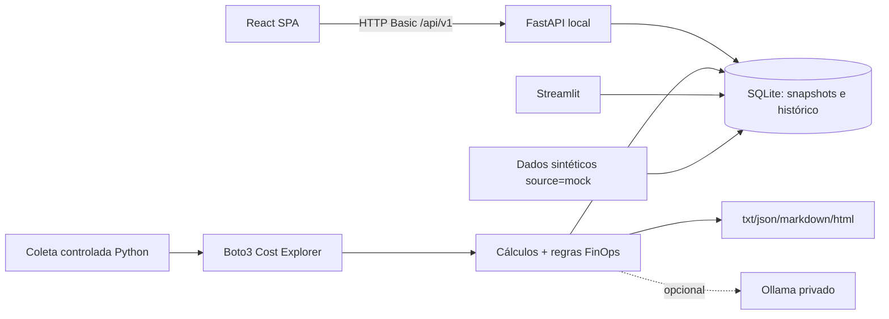

<p align="right"><strong>Português</strong> · <a href="README.en.md">English</a></p>

# AWS Cost Monitor — Cloud Engineering e FinOps v0.2

Custos AWS dispersos dificultam entender concentração, crescimento e alocação. Este projeto de portfólio reúne coleta controlada, análises financeiras determinísticas, snapshots auditáveis e uma interface para explorar os resultados, sem transformar cada acesso ao dashboard em uma consulta potencialmente cobrada.

**React apresenta. FastAPI disponibiliza snapshots. Python calcula. Ollama interpreta opcionalmente.**

## Estado real da entrega

| Componente | Estado |
| --- | --- |
| Python, Boto3, regras FinOps e relatórios | Preservados, testados com dados sintéticos/mocks |
| SQLite e API FastAPI /api/v1 | Implementados e testados localmente, com autenticação de operador único |
| React/TypeScript | Integração HTTP real local validada; modo mock preservado e identificado |
| Streamlit | Preservado; histórico local por padrão e cache no modo AWS explícito |
| Ollama | Cliente textual opcional existente; modelo real e inferência não verificados |
| CloudFormation Lambda/EventBridge/S3 | Template validado estaticamente; **não implantado** |
| CI | Workflow criado; execução no GitHub ainda não verificada |
| AWS real, preços e Free Tier da conta | Não consultados nem verificados; **não há garantia de gratuidade** |

## Arquitetura e requisitos



GETs não chamam AWS nem Ollama. Autenticação, validação Pydantic, números finitos, períodos com fim exclusivo, erros seguros, correlação e limites de chamadas fazem parte dos requisitos não funcionais. Credenciais AWS nunca entram no navegador.

- [Arquitetura, requisitos e limites](docs/architecture-v02.md)
- [Auditoria D0 com evidências e recomendações](docs/audits/technical-audit-v02.md)
- [Decisões arquiteturais ADR](docs/adr/001-v02-boundaries.md)
- [Roadmap D0–D4](docs/roadmap-cloud-finops-v02.md)

## Executar localmente sem AWS

Pré-requisitos: Python 3.14+, uv e Node.js 22.12+ (validação local com Node 24).

```bash
uv sync --frozen --dev
uv run python scripts/seed_demo.py --database data/demo.db
export DATABASE_PATH=data/demo.db
export API_USERNAME=operator
read -r -s -p 'Senha local da API (16+ caracteres ASCII): ' API_PASSWORD
export API_PASSWORD
uv run uvicorn src.api.app:create_app --factory --no-access-log --host 127.0.0.1 --port 8000
```

Em outro terminal:

```bash
cd frontend
npm ci
VITE_DATA_MODE=api npm run dev -- --host 127.0.0.1
```

Abra o endereço local informado pelo Vite e entre com a credencial configurada no servidor. O banco de demonstração é separado, source=mock, e não substitui dados reais existentes. O seed recusa sobrescrever arquivos. Sem API: `npm run dev` usa mocks isolados por padrão.

A API é para **um operador com acesso de leitura ao workspace inteiro**. Não é solução multitenant. Senha ASCII de16–256caracteres, somente no servidor; a SPA mantém Authorization apenas em memória. Fora de loopback, TLS e proteção contra tentativas repetidas são requisitos antes de publicação.

## Configuração e contratos

| Variável | Local | Função |
| --- | --- | --- |
| DATABASE_PATH | Servidor | SQLite, default data/costs.db |
| API_USERNAME / API_PASSWORD | Servidor | Operador e senha obrigatória; não colocar em VITE_* |
| VITE_DATA_MODE | Frontend, público | mock (default) ou api |
| VITE_API_BASE_URL | Frontend, público | /api/v1; proxy Vite para 127.0.0.1:8000 |
| VITE_MOCK_SCENARIO | Frontend, público | success, empty, error, loading, ai-unavailable, ai-processing |
| AWS_REGION / COST_PERIOD_DAYS / COST_TAG_KEY | Coletor | Região, janela e agrupamento; credenciais pela cadeia boto3 |
| AI_ENABLED / LLAMA_BASE_URL / LLAMA_MODEL | Python | Camada opcional; nunca chamar Ollama pelo navegador |

Rotas autenticadas: `/api/v1/snapshots/latest`, `/api/v1/runs`, `/api/v1/runs/{id}`, downloads `/reports/json` e `/reports/csv`, `/api/v1/openapi.json`. Health: `/health/live` público e `/health/ready` autenticado. [Contrato implementado](docs/api-v02.md).

Não há fallback silencioso para mocks em falha HTTP. Janelas/tag só retornam snapshots compatíveis; comparações só usam janelas adjacentes e de mesmo escopo/duração. Créditos são preservados. Datas e valores não são inventados para dados legados sem metadados.

## Funcionalidades e compatibilidade

- Visão geral em USD, estimativas, evolução diária quando disponível, distribuição e ranking.
- Filtros de período/tag persistidos, busca e ordenação visual por serviço; sem cálculos FinOps em TypeScript.
- Alertas determinísticos de crescimento, concentração, ranking e recursos sem tag; crescimento por limiar não é anomalia estatística.
- Histórico, detalhes e comparação de execuções; tema escuro/claro, responsividade, estados de erro/vazio e navegação por teclado.
- Texto IA opcional; seções estruturadas e proveniência avançada continuam planejadas.
- CLI e quatro formatos locais preservados:

```bash
uv run python main.py --help
# Os comandos abaixo consultam AWS e podem gerar cobrança; não fazem parte da demonstração:
uv run python main.py --format json --no-ai
uv run python main.py --days 15 --granularity DAILY --format markdown
uv run streamlit run dashboard.py
```

Configurações Python detalhadas: [configuration.md](docs/configuration.md). Análise existente: [code-structure.md](docs/code-structure.md). A API não promove automaticamente registros legados sem origem/timezone; o histórico antigo permanece acessível pelo Streamlit. Ver plano de migração/backup no runbook.

## Testes, operação e segurança

```bash
uv run pytest -q
uv run python scripts/security_audit.py
uv run cfn-lint infra/serverless.yaml
cd frontend
npm test
npm run test:contract
npm run lint
npm run build
```

Testes não usam AWS/Ollama reais. Há contrato FastAPI → Pydantic → JSON → Zod, regressões de segurança, falhas de coleta e validação de navegador contra servidor real local. [Resultados e limitações](docs/validation-v02.md).

[Runbook](docs/runbook-v02.md): logs JSON, request_id, health/readiness, banco/backup, recuperação de coleta, timeouts e troubleshooting. A rotina de coleta reservada é separada da API; cache Streamlit não substitui uma trava diária global.

## Infraestrutura preparada e custos

`infra/serverless.yaml` prepara coletor Lambda, EventBridge diário desabilitado, S3 privado criptografado, logs com retenção e IAM mínimo. Não hospeda API/SPA ou SQLite. `scripts/package_lambda.py` cria ZIP local sem upload/deploy.

[Implantar/remover futuramente](docs/infrastructure-v02.md). O bucket é retido após exclusão da stack; dados e cobrança podem permanecer. [Custos potenciais](docs/costs-v02.md): CE por requisição/página, Lambda, S3/versões/transferência, logs, eventos e CI. Free Tier depende da conta e das tabelas vigentes; desempenho e custo em AWS não foram medidos.

## Estrutura e próximos passos

`src/api` HTTP/auth; `src/application` modelos/mapeamento; `src/database` persistência; `src/operations` coleta/guarda; `src/analysis`, `src/aws`, `src/ai`, `src/reports` motores existentes; `frontend` SPA; `infra` template; `tests` regressões; `docs` auditoria/ADRs/runbooks.

Próximos trabalhos: importação legada com proveniência aprovada, migração financeira para Decimal com equivalência, autenticação corporativa/rate limiting, IA estruturada com avaliação, armazenamento durável e API cloud, métricas/alertas operacionais e validação AWS controlada. Multi-conta, previsão e anomalias estatísticas permanecem roadmap, não funcionalidades concluídas.

MIT — José Airton de Carvalho Neto / NETTO LABS. [GitHub](https://github.com/AirtonNettu).
