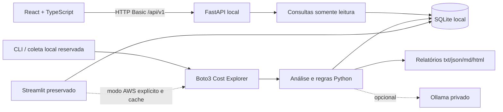
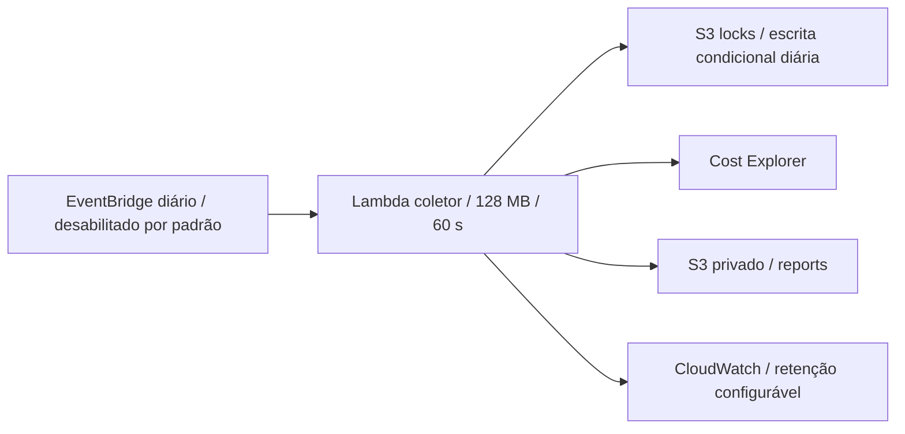

# AWS Cost Monitor v0.2 — arquitetura e requisitos

## Problema e objetivo

Custos dispersos por serviço dificultam rastreabilidade, alocação e identificação de concentração. O objetivo de portfólio é demonstrar integração segura, análise determinística, operação controlada e infraestrutura reproduzível. A solução não substitui auditoria financeira nem comprova desperdício sem dados de utilização.

## Requisitos

Funcionais: coletar custos por serviço OU chave de tag; calcular totais/percentuais/alertas em Python; manter relatórios e Streamlit; persistir snapshots; disponibilizar histórico, filtros e downloads pela API; permitir interpretação Ollama opcional e demonstração sem AWS.

Não funcionais: GET sem cobrança AWS, autenticação de leitura, erros seguros, números finitos, fim de período exclusivo, timezone, limites de rede/paginação, credenciais fora do bundle, recuperação documentada e validação automatizada.

## Implementação e fronteiras

- `src/api/app.py`: factory, auth, erros, correlação, health, rotas. Sem imports/invocações de coleta nas rotas.
- `src/application/snapshots.py`: modelos Pydantic, mapeamento de alertas e comparação equivalente.
- `src/database/{repository,snapshots}.py`: gravação transacional e leitura readonly.
- `src/operations/collection.py`: reserva diária por banco local, estados running/succeeded/failed. Não há endpoint de coleta.
- React: credenciais HTTP Basic em memória, sem localStorage/sessionStorage/VITE_PASSWORD. Refresh exige novo login; sair desmonta a aplicação e seu cache.
- IA preserva texto existente e campos opcionais vazios. Não há geração estruturada, fine-tuning, jobs de IA ou avaliação semântica nova.

## Dados e migração

As tabelas `runs`/`service_costs` são preservadas. `init_db` acrescenta `snapshots` e `collection_jobs`, índice de filtros e coluna run_id quando necessária. O snapshot JSON passa por Pydantic; falha de gravação é rollback de run/serviços/snapshot. FK e busy timeout são ativados nas conexões de escrita. API abre SQLite com `mode=ro` após startup.

Snapshots novos guardam origem, timestamp UTC, período, créditos, estimativa, tag de agrupamento e série diária apenas quando realmente diária. Percentuais continuam derivados do motor Python; créditos podem produzir participações acima de 100%, não devem ser normalizados como verdade financeira.

Comparação exige janela anterior adjacente, mesma duração, origem e tag. Sem isso, retorna null, mesmo que o CLI legado compare buckets. Os alertas da API usam a comparação de janela, não a porcentagem entre buckets. Valores de alertas não são recalculados em TypeScript.

Registros anteriores à migração continuam acessíveis no Streamlit/CLI, mas não entram automaticamente na API: source, timezone e estimated seriam suposições. Para importá-los é necessário um migrador com proveniência aprovada (planejado). Fazer backup antes de atualizar; não executar downgrade com escrita concorrente.

## Segurança

O modelo atual é um workspace de um operador, sem tenants: a credencial configurada autoriza todos os snapshots e downloads desse workspace. Usuário/senha são ASCII, usuário sem dois-pontos, senha de 16–256 caracteres. O servidor recusa configuração ausente. Não é autenticação corporativa; TLS, limitação de tentativas e identidade por usuário são requisitos antes de publicação externa.

CORS não é habilitado: desenvolvimento usa proxy Vite na mesma origem, produção exige reverse proxy revisado. API não usa cookies de autenticação e não tem rotas de mutação. HTTP Basic fora de loopback exige TLS. Segredos AWS ficam na cadeia boto3 apenas no coletor; API não exige credenciais AWS.

## Infraestrutura preparada, não implantada

A stack não hospeda FastAPI, React ou SQLite. O pacote Lambda usa módulos puros Python e boto3 fornecido pelo runtime, sem Streamlit/Pydantic. Compatibilidade e IAM precisam de validação controlada futura em conta de teste. Ver [infraestrutura](infrastructure-v02.md), [ADR](adr/001-v02-boundaries.md), [custos](costs-v02.md).

Estabilização: [ADR-002](adr/002-recovery-and-deadlines.md) define transação de conclusão local, recuperação manual limitada, escrita diária condicional no S3 e orçamento serverless. Guardas legadas sem identidade não são reabertas automaticamente.
