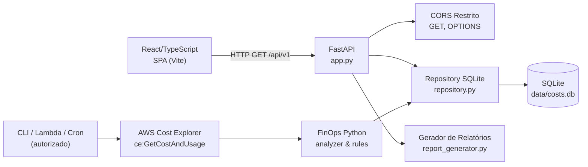

# Arquitetura — FastAPI e Integração de Snapshots (PR #7)

**Status:** Implementado e aprovado em testes unitários e de integração na branch `feat/fastapi-snapshot-api`.

## Contexto e Objetivo
O AWS Cost Monitor possui motor determinístico de FinOps em Python e um dashboard SPA React/TypeScript. A PR #7 implementa a camada HTTP FastAPI que expõe os snapshots persistidos em SQLite, sem permitir que requisições de leitura disparem chamadas ao AWS Cost Explorer ou gerem custos.

## Responsabilidades e Fronteiras
- **React (Frontend):** Apresentação, filtros dinâmicos, gráficos Recharts, acessibilidade e gerenciamento de estado via `@tanstack/react-query`. O cliente pode operar em modo `mock` ou `api` via `createDataClient()`.
- **FastAPI (`src/api/app.py`):** Validação estrita via Pydantic v2 (`ConfigDict(extra="forbid")`), rotas REST com prefixo `/api/v1`, proteção CORS, in-memory report streaming (prevenindo path traversal) e mapeamento defensivo de erros.
- **Repositório SQLite (`src/database/repository.py`):** Persistência de snapshots com migração incremental automática e idempotente. Suporte a consultas paginadas e filtragem por `(days, tag)`.
- **Regra FinOps Inegociável:** Python calcula e normaliza dados financeiros; FastAPI apenas serve os snapshots salvos.

## ADRs (Architectural Decision Records)

- **ADR-001 FastAPI como camada HTTP:** Adota FastAPI para unificar documentação OpenAPI e validação Pydantic com baixa latência e tipagem nativa Python.
- **ADR-002 Leitura puramente cacheada:** Nenhum endpoint HTTP de leitura realiza chamada à AWS. Os snapshots consultados vêm exclusivamente do SQLite local.
- **ADR-003 IA desacoplada no snapshot:** O objeto `Snapshot.ai` expressa estados explícitos (`ready`, `processing`, `unavailable`). A indisponibilidade de Ollama não impede a visualização dos dados financeiros.
- **ADR-004 SQLite incremental:** Mantém SQLite sem necessidade de infraestrutura pesada (Postgres/Redis), adicionando índices e colunas de forma transacional e reversível.
- **ADR-005 API versionada `/api/v1`:** Garante estabilidade contratual para o cliente React.
- **ADR-006 Isolamento de relatórios em memória:** Downloads de relatórios reconstituem os dados a partir do banco e utilizam builders em memória com Content-Disposition seguro, eliminando riscos de path traversal no sistema de arquivos.
- **ADR-007 Migração incremental com preservação de dados legados:** A função `init_db` verifica colunas existentes via `PRAGMA table_info(runs)` e executa `ALTER TABLE runs ADD COLUMN` apenas para as ausentes. Dados legados permanecem intactos.
- **ADR-008 Alinhamento estrito Pydantic-Zod e timezone UTC:** Modelos Pydantic aplicam validadores de formato de data ISO `YYYY-MM-DD` com `start < end` e serializam timestamps com fuso UTC obrigatório para satisfazer a checagem `z.iso.datetime({ offset: true })` do Zod. Snapshots legados sem timezone retornam HTTP 409 em vez de falsificar fuso.

## Requisitos Não Funcionais Validados
- **Performance:** Consultas indexadas por `(days, tag)` e `created_at DESC`.
- **Segurança:** 0 credenciais no frontend e no código; auditoria NETTO LABS 100% aprovada.
- **QA:** Cobertura de testes unitários e de integração em Python (pytest) e TypeScript (vitest).
