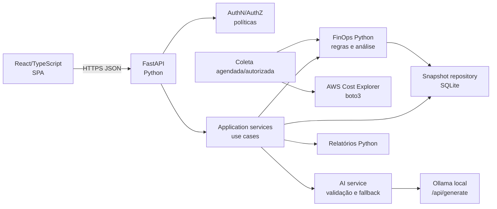

# Arquitetura proposta — FastAPI e AI Application Engineering

**Status:** proposta; não é descrição de componentes já implantados.

## Contexto e objetivo
O AWS Cost Monitor já calcula e armazena resultados de FinOps em Python. O frontend React apresenta snapshots fictícios porque ainda não existe servidor FastAPI. Construiremos uma camada HTTP que exponha snapshots reais **já persistidos**, sem transformar navegação em consultas cobradas ao Cost Explorer.



## Responsabilidades e fronteiras
- **React:** UI, filtros, gráficos, acessibilidade, estado remoto e mensagens de erro. Nunca segredos, cálculos críticos ou acesso direto a AWS/Ollama.
- **FastAPI:** autenticação, autorização, validação Pydantic, HTTP, DI, rate limits, status, mapeamento de erros e OpenAPI.
- **Application:** casos de uso `GetLatestSnapshot`, `ListRuns`, `GetRun`, `DownloadReport`, `AnalyzeSnapshotWithAI`, sem dependência de framework web.
- **Domain:** entidades Snapshot/Run, invariantes, comparação equivalente, regras FinOps determinísticas.
- **Infrastructure:** adaptadores SQLite, boto3, Ollama, relatórios e logs. Dependências apontam para interfaces.
- **Coleta:** job separado e explicitamente autorizado; nunca disparado por GET de dashboard.

## Fluxos
### Leitura de snapshot
1. React requisita `GET /api/v1/snapshots/latest?days=30`.
2. FastAPI autentica/autoriza, valida filtros.
3. Serviço lê último snapshot persistido compatível com período e tag.
4. Mapper valida schema e serializa JSON, incluindo `source`, `collected_at`, `estimated`.
5. 404 quando não há snapshot; **não** consultar AWS automaticamente.

### Coleta
1. Agendamento ou operador autorizado dispara job separado.
2. Adaptador boto3 coleta com granularidade e limite de chamadas.
3. Python calcula, compara períodos equivalentes e produz alertas.
4. Persistência transacional grava snapshot e metadados; evitar duplicação por idempotência.
5. IA pode interpretar snapshot posteriormente; falha de IA não invalida coleta.

### Análise IA
1. Backend seleciona snapshot existente e constrói payload factual validado.
2. Serviço IA aplica política de contexto, tamanho e sanitização de dados.
3. Adaptador Ollama envia requisição com timeout e parâmetros fixados.
4. Saída é parseada, validada, checada contra fatos e persistida com status/modelo/versão do prompt.
5. Resposta indisponível ou inválida é sinalizada sem afetar o snapshot.

## Estrutura sugerida (não criada)
```text
src/
  api/
    app.py
    routers/{snapshots,runs,reports,ai,health}.py
    schemas/{snapshot,ai,error}.py
    dependencies.py
  application/
    services/{snapshot_service,report_service,ai_service}.py
    ports/{snapshot_repository,ai_provider}.py
  domain/
    models.py
    policies.py
  infrastructure/
    persistence/
    ai/ollama_provider.py
    aws/
```
Preservar os módulos atuais e migrar por adaptadores; não mover código apenas por estética.

## ADRs propostos
- **ADR-001 FastAPI como camada HTTP:** separa SPA de regras e habilita OpenAPI/Pydantic; custo: manutenção de serviço adicional.
- **ADR-002 leitura cacheada:** GET não chama Cost Explorer; custo: dados podem estar defasados e exigem `collected_at` visível.
- **ADR-003 IA opcional e desacoplada:** FinOps funciona sem Ollama; custo: estados explícitos `unavailable` e `processing`.
- **ADR-004 SQLite inicialmente:** reutiliza persistência existente para uso local; custo: concorrência, backups e migrações exigem atenção.
- **ADR-005 API versionada /api/v1:** contrato estável com frontend; mudanças incompatíveis exigem revisão de versão.
- **ADR-006 não expor Ollama na internet:** comunicação server-side restrita a loopback/rede privada, sem proxy aberto.

## Requisitos não funcionais
Contratos tipados; logging com request_id sem credenciais; testes isolados de AWS/Ollama; timeouts; CORS restrito; proteção de downloads; sem consultas cobradas por navegação; modo desenvolvimento sem conta AWS; documentação OpenAPI alinhada ao Zod.

## Pontos que exigem decisão antes do código
Modelo de autenticação para uso local vs publicação; origem e ciclo de vida dos snapshots; necessidade de múltiplas contas; política de retenção; frequência de coleta; uso de inferência síncrona ou jobs; persistência de série temporal; orçamento máximo de AWS.
