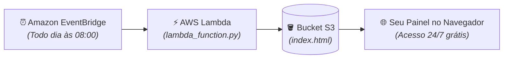

# Guia de Deploy Serverless — AWS Lambda + S3 Website (Custo R$ 0,00)

> Este guia ensina como colocar o **AWS Cost Monitor** online na sua conta AWS **sem gastar 1 centavo**, usando **AWS Lambda** (Always Free), **Amazon S3** (Hospedagem Estática) e **Amazon EventBridge** (Agendamento diário).

---

## Como a arquitetura funciona



---

## Passo 1: Criar o Bucket S3 para a Dashboard

1. Acesse o **Console da AWS** e vá em **Amazon S3**.
2. Clique em **Criar bucket**.
3. Escolha um nome único (ex: `meu-finops-dashboard-2026`).
4. Em **Bloquear todo o acesso público**, desmarque a caixa (para permitir que seu navegador abra o HTML) e marque a caixinha de confirmação.
5. Clique em **Criar bucket**.

### Ativar a Hospedagem de Site Estático:
1. Entre no bucket criado > aba **Propriedades** (Properties).
2. Role até o final em **Hospedagem de site estático** (Static website hosting) e clique em **Editar**.
3. Selecione **Ativar** (Enable).
4. Em **Documento de índice**, digite: `index.html`.
5. Clique em **Salvar alterações**.
6. Guarde a **URL do ponto de extremidade** (Endpoint) que a AWS exibe (esse será o seu link do site!).

### Adicionar Política de Leitura Pública no S3:
1. Vá na aba **Permissões** (Permissions) > **Política do bucket** (Bucket Policy) > **Editar**.
2. Cole a política abaixo (substitua `NOME_DO_SEU_BUCKET` pelo nome real):
```json
{
  "Version": "2012-10-17",
  "Statement": [
    {
      "Sid": "PublicReadGetObject",
      "Effect": "Allow",
      "Principal": "*",
      "Action": "s3:GetObject",
      "Resource": "arn:aws:s3:::NOME_DO_SEU_BUCKET/*"
    }
  ]
}
```
3. Clique em **Salvar alterações**.

---

## Passo 2: Criar a Role de Permissão no IAM

A Lambda precisa de permissão para ler custos do Cost Explorer e gravar o arquivo no S3.

1. Vá em **IAM** > **Funções** (Roles) > **Criar função**.
2. Tipo de entidade: **Serviço da AWS** > Caso de uso: **Lambda** > Próximo.
3. Adicione as seguintes permissões:
   - `AWSLambdaBasicExecutionRole` (para logs no CloudWatch).
4. Crie uma política inline adicional com permissão para:
```json
{
  "Version": "2012-10-17",
  "Statement": [
    {
      "Effect": "Allow",
      "Action": "ce:GetCostAndUsage",
      "Resource": "*"
    },
    {
      "Effect": "Allow",
      "Action": "s3:PutObject",
      "Resource": "arn:aws:s3:::NOME_DO_SEU_BUCKET/*"
    }
  ]
}
```
5. Nome da função: `aws-cost-monitor-lambda-role` > **Criar função**.

---

## Passo 3: Criar e Configurar a Função AWS Lambda

1. Vá em **AWS Lambda** > **Criar função**.
2. Escolha **Criar do zero**:
   - Nome: `aws-cost-monitor-daily`
   - Runtime: **Python 3.12** ou superior.
   - Permissões: Escolha a role criada no Passo 2 (`aws-cost-monitor-lambda-role`).
3. Clique em **Criar função**.

### Configurar Variáveis de Ambiente:
1. Na aba **Configuração** > **Variáveis de ambiente** > **Editar**:
   - `S3_BUCKET_NAME`: nome do seu bucket criado no Passo 1.
   - `COST_PERIOD_DAYS`: `30`
   - `COST_GRANULARITY`: `DAILY`
2. Clique em **Salvar**.

### Configurar Timeout da Lambda:
1. Na aba **Configuração** > **Configuração geral** > **Editar**:
   - Mude o Timeout de 3s para **15 segundos** (tempo suficiente para o Cost Explorer responder).

---

## Passo 4: Fazer o Upload do Código

Gere um arquivo zip simples com o projeto e envie para a Lambda:

No seu computador, no PowerShell do projeto:
```powershell
# Cria o arquivo lambda_package.zip contendo o código
Compress-Archive -Path lambda_function.py, src -DestinationPath lambda_package.zip -Force
```

1. No console da Lambda, vá em **Código** > **Fazer upload de** > **Arquivo .zip**.
2. Selecione o arquivo `lambda_package.zip`.
3. Clique em **Salvar**.
4. Clique em **Test** para rodar a primeira vez manualmente!
   - A Lambda vai consultar os custos, gerar o `index.html` e enviar para o S3.
   - Abra a URL do seu S3 no navegador e veja sua dashboard funcionando!

---

## Passo 5: Agendar a Execução Diária (Amazon EventBridge)

1. No console da sua Lambda, clique em **+ Adicionar gatilho** (Add trigger).
2. Selecione **EventBridge (CloudWatch Events)**.
3. Escolha **Criar uma nova regra**:
   - Nome da regra: `aws-cost-monitor-daily-trigger`
   - Expressão de agendamento: `cron(0 11 * * ? *)` *(executa todo dia às 11:00 UTC = 08:00 da manhã no horário de Brasília)*.
4. Clique em **Adicionar**.

---

## Pronto! 🎉

A partir de agora:
* Todo dia às 08:00 a AWS acorda a Lambda por 3 segundos.
* A Lambda atualiza os gráficos e valores da sua fatura no S3.
* O link do seu S3 fica online **24 horas por dia, 365 dias por ano**, sem nenhum servidor ligado e com custo **R$ 0,00 vitalício**.
